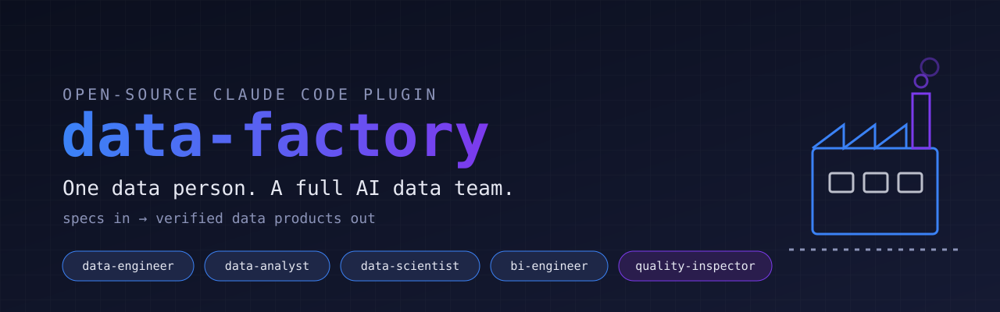
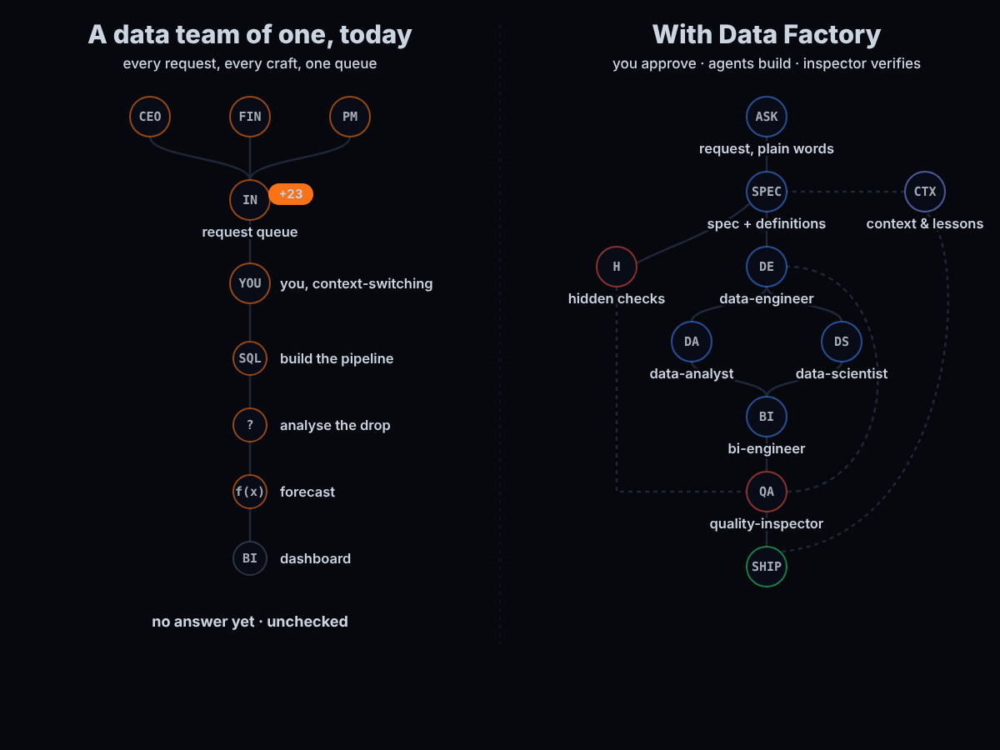
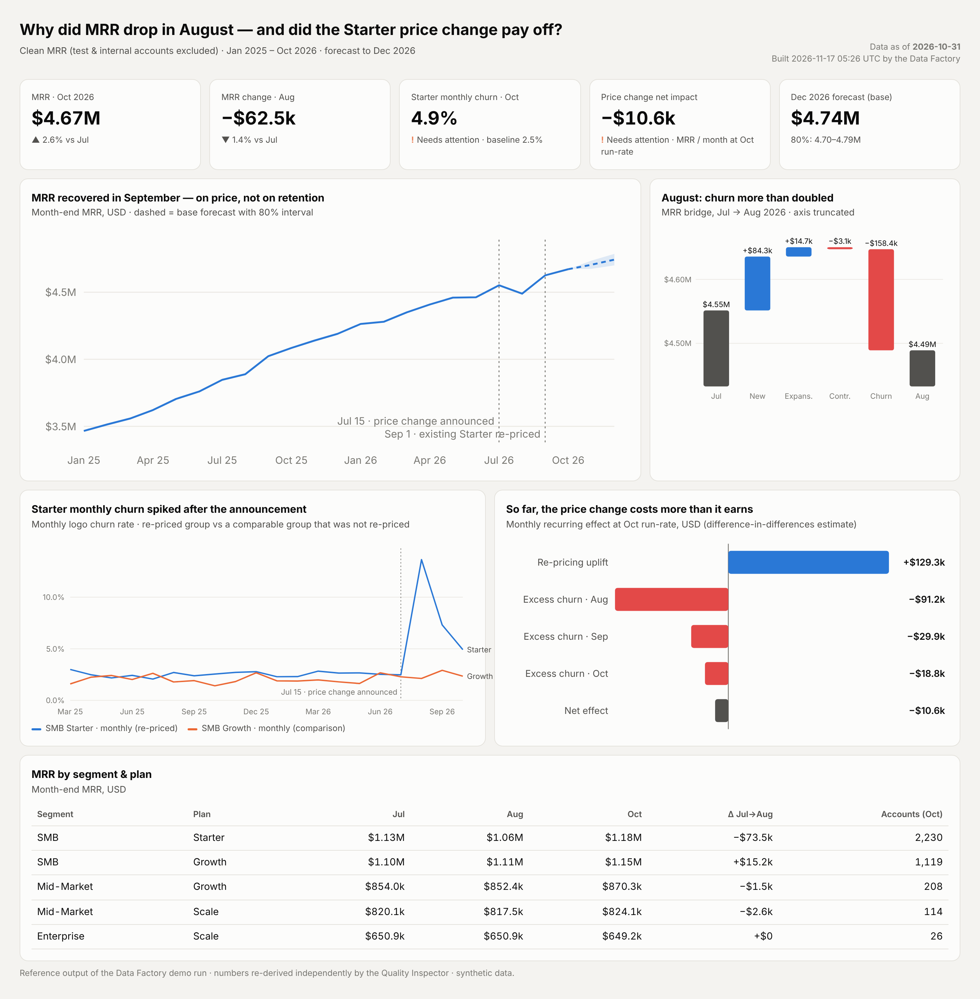
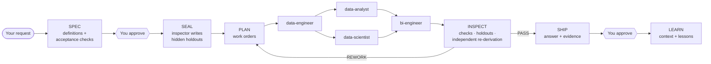

<p align="center"></p>

<p align="center">
  <a href="LICENSE"></a>
  
  
  <a href="CONTRIBUTING.md"></a>
</p>

<h2 align="center">Your data team is one person.<br>Data Factory gives them a whole team.</h2>

<p align="center">
  A <b>data engineer</b>, an <b>analyst</b>, a <b>data scientist</b> and a <b>BI engineer</b> do the work.<br>
  A <b>quality inspector</b> checks every number. <b>You just approve.</b>
</p>

<p align="center"></p>

<p align="center">
  <a href="#start-here"><b>▶ Try it in 5 minutes</b></a> &nbsp;·&nbsp;
  <a href="examples/mrr-drop"><b>👀 See a real run</b></a> &nbsp;·&nbsp;
  <a href="docs/use-cases.md"><b>💡 What can I ask it?</b></a>
</p>

## How it works, in plain words

1. **You ask** in plain English → `/data-factory:run Why did MRR drop in August?`
2. **It writes a spec** that pins down every word ("revenue", "active", "last month") → **you approve it**
3. **Four AI specialists build** the tables, the analysis, the forecast and the dashboard
4. **An inspector checks every number** against hidden tests and your finance figures → mistakes go back for rework
5. **You get the answer + the proof** → **you decide** what ships. Nothing touches production without you.

It's the **software factory** idea that engineering teams adopted in 2026 (agents build, an independent system verifies, humans set intent) — applied to data. [Why it works →](docs/concept.md)

### It catches what people miss

> In the [reference run](examples/mrr-drop), every visible check passed on the first build. The inspector's **hidden checks** still caught **1,132 duplicated invoices** (revenue overstated by 46%) and **3 internal test accounts** that made the August drop look 76% bigger and blamed the wrong customers. One rework loop later, every number matched finance — to the dollar.

<p align="center"></p>

---

## Start here

**Try it on demo data (5 minutes, no warehouse):**
```bash
git clone https://github.com/nimrodfisher/data-factory && cd data-factory/demo
pip install duckdb pandas numpy && python generate_data.py
claude
```
```
/plugin install data-factory --marketplace nimrodfisher/data-factory
/data-factory:run MRR dropped in August. Why — and was the Starter price increase a mistake? Forecast to December and give me a dashboard to track it.
```

**Use it on your own data (3 steps):**
1. Open Claude Code in your data repo (dbt or SQL) and install: `/plugin install data-factory --marketplace nimrodfisher/data-factory`
2. `/data-factory:init` — it detects your stack and asks you at most 3 questions.
3. Ask anything: `/data-factory:run <your request in plain words>`

<sub>Older Claude Code: `/plugin marketplace add nimrodfisher/data-factory` then `/plugin install data-factory@data-factory`.</sub>

Then fill two files and you're 80% there: `.data-factory/context/metrics.md` (your definitions) and `.data-factory/context/truths.md` (3 numbers you trust from finance or the board deck).

---

## What you can hand to it

| You need… | Type | You do |
|---|---|---|
| "Why did this number change?" | `/data-factory:run Signups dropped 18% last week — real? why?` | approve spec, read answer |
| A Monday KPI review, automatically | `/data-factory:run weekly-kpi-review` (or schedule it) | skim the PR |
| A dashboard | `/data-factory:run dashboard-request` | approve brief, publish |
| A new data source in the warehouse | `/data-factory:run new-source-onboarding` | approve each step, merge PR |
| An A/B test readout | `/data-factory:run experiment-readout` | approve the spec |
| A forecast for the board | `/data-factory:run monthly-forecast` | review scenarios |
| A second opinion on existing work | `/data-factory:inspect models/marts/finance/` | read the verdict |
| To scope a vague ask | `/data-factory:spec "a single view of the customer"` | send the questions back |

Six of these are **ready-made specs** that `init` installs into `.data-factory/specs/` — edit once, re-run forever.
→ Details and examples: [**docs/use-cases.md**](docs/use-cases.md)

## Where your team talks to it

| Who | Where | Setup |
|---|---|---|
| You (data lead) | Claude Code — terminal, IDE, web, phone | install the plugin |
| Stakeholders | a **"📊 Data request" GitHub issue** → spec comment → you approve → PR | [2 files](integrations/) |
| Stakeholders | **Slack**: tag `@Claude` in `#data-requests` | Claude Team/Enterprise |
| Nobody | **scheduled** runs (weekly KPIs, monthly forecast) → PR | [1 file](integrations/github/scheduled-recipe.yml) |

→ Copy-paste setup: [**docs/interfaces.md**](docs/interfaces.md) · Running a 1–2 person team on it: [**docs/lean-team.md**](docs/lean-team.md)

---

## How it works



| Software factory idea | In Data Factory |
|---|---|
| Specs drive agents | `spec.md` — the decision, every metric word defined, testable acceptance checks |
| Scenarios hidden from coding agents | **Sealed holdouts** — truth anchors, invariants and known traps the builders never see |
| Specialised agents | Four builder stations with deep, on-demand knowledge |
| Verification you can trust | An **independent inspector** that re-derives headline numbers from raw data |
| Humans set intent & approve | Two gates: the spec and the ship. Nothing ever touches production on its own |
| The trace, not the code | Every run leaves `spec → orders → handoffs → inspection → ship` |
| Compounding | Definitions, source quirks and lessons are written back after every run |

Read the full reasoning in [**docs/concept.md**](docs/concept.md).

## The team

| Agent | Does | Knows (loaded on demand) |
|---|---|---|
| 🔵 **data-engineer** | sources → staging → marts, tests, pipelines | ingestion & CDC, incremental/idempotent loads, Kimball & SCD2, orchestration, SQL traps & cost |
| 🟢 **data-analyst** | questions → reproducible findings memo | metric trees, "why did X change" playbook, cohorts/funnels, mix-shift & Simpson's, pyramid-style memos |
| 🟣 **data-scientist** | forecasts, experiments, causal estimates, models | baselines first, A/B design & SRM & CUPED, forecasting & backtests, leakage hunting, DiD/synthetic control, model cards |
| 🟠 **bi-engineer** | semantic layer, dashboards | dashboard design for decisions, chart selection, metric governance, LookML/DAX/Tableau/Metabase/…, zero-dependency HTML dashboards |
| 🔴 **quality-inspector** | sealed holdouts, inspection, verdict | test pyramid, reconciliation, holdout design, adversarial review per station |

You are the **Factory Manager's boss**: the main Claude Code session plays Factory Manager (spec, plan, dispatch, gates); you own intent, definitions, truths and approvals.

## Why you can trust the output

1. **Definitions before SQL.** Vague words ("active", "revenue", "last month") must be defined in the spec before any station starts.
2. **Truth anchors.** Put 3–5 known-good numbers (finance close, board deck, CRM count) in `context/truths.md`. Outputs must reconcile to them.
3. **Sealed holdouts.** The inspector writes them *before* the build; builders are told never to read them. Visible checks can be gamed; sealed ones measure.
4. **Independent re-derivation.** The inspector recomputes the 1–3 headline numbers from raw data with its own query.
5. **Safety interlock.** A hook blocks `DROP`, `TRUNCATE`, unbounded `DELETE`/`UPDATE`, writes to your prod schema and dbt/SQLMesh prod targets.
6. **Two human gates.** You approve the spec and anything that ships. Production changes arrive as a PR.

## Works with your stack

| Layer | Supported |
|---|---|
| Warehouse | Snowflake · BigQuery · Databricks · Redshift · Postgres · DuckDB/MotherDuck (+ any SQL via CLI or MCP) |
| Transform | dbt · SQLMesh · plain SQL |
| Orchestration | Airflow · Dagster · Prefect · dbt Cloud · GitHub Actions |
| BI | Looker · Power BI · Tableau · Metabase · Superset · Lightdash · Hex · Streamlit · self-contained HTML |
| Run SQL via | any CLI (`snow sql`, `bq`, `psql`, `duckdb`, `dbt show`) or a database **MCP server** |

Missing yours? It's one markdown file — see [CONTRIBUTING.md](CONTRIBUTING.md).

## Commands

| Command | What it does |
|---|---|
| `/data-factory:init` | detect your stack, create `.data-factory/` (config, context, memory) |
| `/data-factory:run <request>` | the full line: spec → seal → plan → build → inspect → ship → learn |
| `/data-factory:spec <request>` | just write the spec (great for scoping requests from stakeholders) |
| `/data-factory:inspect [path]` | run the inspector on a run, a model, a query or someone's analysis |
| `/data-factory:status` | the factory floor: every run, its stage, what's waiting on you |
| `/data-factory:learn <fact>` | teach a definition, source quirk, truth anchor or lesson |

You can also call any station directly: *"use the data-scientist agent to design an A/B test for the new onboarding"*.

## Autonomy dial

| `autonomy:` | You approve | Use when |
|---|---|---|
| `supervised` | spec, every handoff, ship | first runs, sensitive data |
| `gated` (default) | spec, ship | day-to-day |
| `lights-out` | nothing during the run — you read the trace | recurring requests with strong truth anchors |

Where is your team? → [**The 6 levels of the Data Factory**](docs/levels.md).

## What's in the repo

```
.claude-plugin/marketplace.json         ← install with /plugin marketplace add
plugins/data-factory/
├── agents/        5 stations (markdown)
├── commands/      init · run · spec · inspect · status · learn
├── skills/        7 knowledge packs, 3-layer: SKILL.md → router.md → references/*.md
│   ├── factory-playbook/   (+ templates and 6 ready-made recipe specs)
│   ├── data-engineering/  data-analysis/  data-science/  bi-engineering/  data-quality/
│   └── platforms/          Snowflake, BigQuery, Databricks, Postgres/Redshift, DuckDB, dbt/SQLMesh, orchestrators, BI tools
├── hooks/         safety interlock
└── scripts/       sql_guard.py
integrations/      copy-paste: .claude/settings.json, GitHub issue form, request & scheduled workflows
demo/              synthetic SaaS in DuckDB + pre-filled .data-factory/
examples/mrr-drop/ a full reference run: trace, SQL, memo, model card, dashboard
docs/              use-cases · interfaces · lean-team · concept · levels · customize
```

Skills load in three layers (lean entry → router → one deep reference), so each agent pulls only the knowledge its task needs.

## FAQ

**How small can the data team be?** One person. The factory covers the four builder crafts; you cover intent, definitions, truths and approvals — about 3 hours a week of "factory management" once it's set up ([lean-team guide](docs/lean-team.md)).

**Is this "no human in the loop"?** No. It's "no human in the *grind*". You own intent, definitions, truths and approvals — the four things that actually determine whether data is right.

**Does it work without Claude Code?** The agents and skills are plain markdown; see [AGENTS.md](AGENTS.md) for Codex, Cursor, Gemini CLI and others. The orchestration commands and the safety hook are Claude Code–specific.

**Will it touch production?** No. Agents build in your dev environment; the hook blocks destructive SQL and prod targets; shipping means a PR you merge. Also give the agent a dev-only warehouse role — defence in depth.

**How much does a run cost?** Depends on the model and the request. An M-size request (2–3 stations) is a normal Claude Code session; L-size runs dispatch more agents. Start with `/data-factory:spec` to scope.

## Contributing

Platform adapters, new stations (analytics engineer, ML engineer, data steward), better holdout patterns, more demos — see [CONTRIBUTING.md](CONTRIBUTING.md). If this is useful, a ⭐ helps others find it.

## Credits

Built by [Nimrod Fisher](https://github.com/nimrodfisher) ([AI Analytics Hub](https://ai-analytics-hub.com)). The software-factory idea comes from the teams who published theirs in 2026 — StrongDM, Factory.ai and others; see [docs/concept.md](docs/concept.md) for sources.

MIT licensed.
