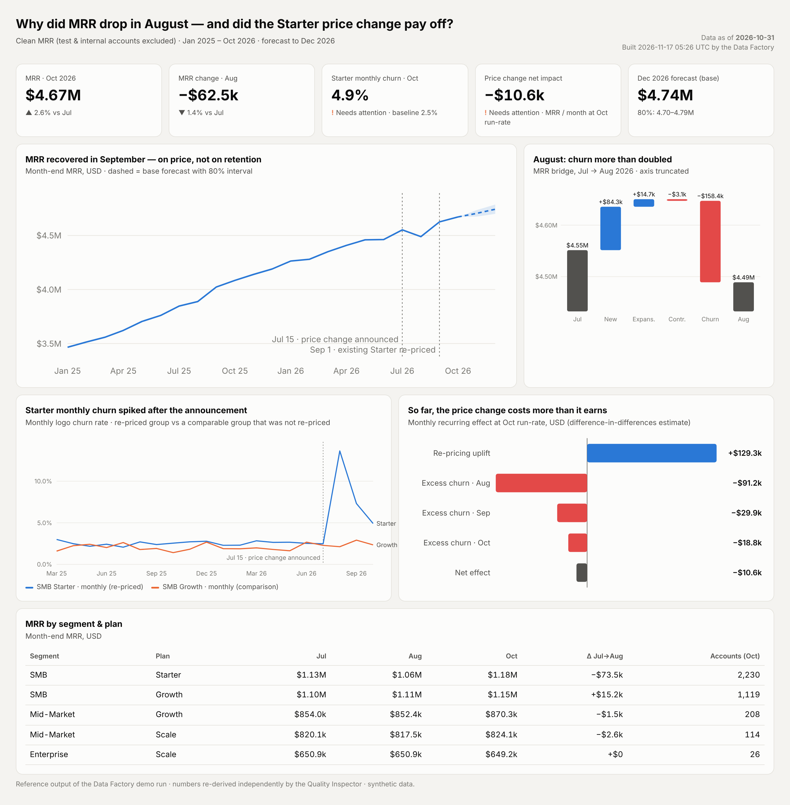

# Reference run: "MRR dropped in August. Why?"

This is what one Data Factory run produces on the [demo dataset](../../demo): a fictional B2B SaaS with ~5,400 accounts, a pricing change, and two traps hidden in the data.

> **Request:** *"MRR dropped in August. Why — and was the Starter price increase a mistake? Forecast to December and give me a dashboard to track it."*



## The trace (read in this order)
| Step | File | Who |
|---|---|---|
| 1. Spec — intent, definitions, 5 acceptance checks | [`run/spec.md`](run/spec.md) | Factory Manager · you approve |
| 2. Sealed holdouts — 7 checks builders never see | [`run/sealed/holdouts.md`](run/sealed/holdouts.md) | quality-inspector |
| 3. Plan — 4 work orders, 2 in parallel | [`run/plan.md`](run/plan.md), [`run/orders/`](run/orders) | Factory Manager |
| 4. Build — models, analyses, models, dashboard | [`run/handoffs/`](run/handoffs) | 4 stations |
| 5. Inspect — loop 1 **REWORK**, loop 2 **PASS** | [`run/inspection.md`](run/inspection.md) | quality-inspector |
| 6. Ship — the answer, evidence, decisions for you | [`run/ship.md`](run/ship.md) | Factory Manager · you approve |
| 7. Learn — what the factory remembers next time | [`run/lessons-added.md`](run/lessons-added.md) | Factory Manager |

## What the inspector caught
The visible acceptance checks all passed on the first build. The **sealed holdouts** didn't:
- **1,132 duplicated invoices** from a connector re-sync → August revenue overstated by **46%**.
- **3 internal QA accounts** in the MRR base → the August drop looked **76% bigger** and was partly blamed on Enterprise churn that never happened.

One rework loop later, every number reconciled to finance and the board deck to the dollar. That's the point of the factory: you review a trace and a verdict, not 40 queries.

## The answer (from [`run/ship.md`](run/ship.md))
MRR fell **$62.5k (−1.4%)** because Starter customers cancelled after the price-increase e-mail. September's rebound is the new price landing on those who stayed, not better retention. **At October's run-rate the increase is net −$10.6k MRR/month** → hold the annual-renewal extension and re-check in January.

## Reproduce it
```bash
pip install duckdb pandas numpy
python ../../demo/generate_data.py   # creates demo/saas.duckdb
python build.py                       # models → tests → analyses → DS → dashboard
open dashboards/mrr_dashboard.html
```
`build.py` replays the stations' final deliverables. Your own `/data-factory:run` will word things differently and may structure SQL differently — but the holdouts make sure it lands on the same numbers.

## Deliverables
`models/` · `tests/` · `analyses/` (+ [`findings.md`](analyses/findings.md)) · `notebooks/` (+ [`model_card.md`](notebooks/model_card.md)) · `dashboards/`
